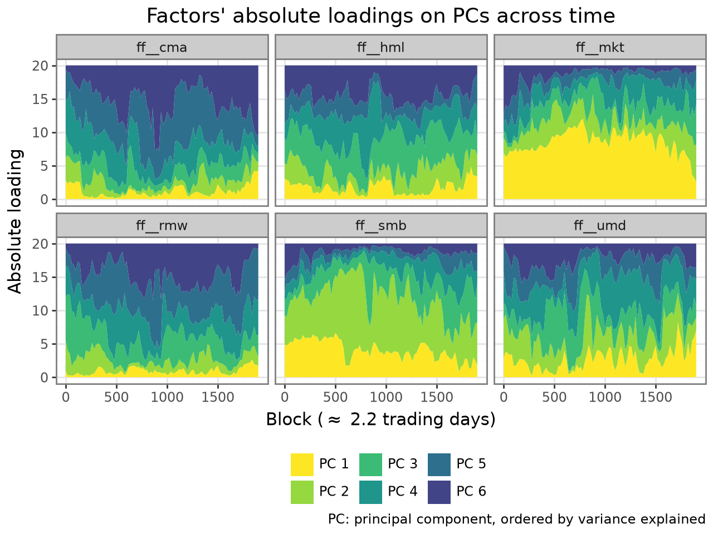

## plot_loadings()


Plot the loading contribution between variables and principal components over time.


Usage

``` python
plot_loadings(
    pca,
    exp=1,
    merge_blocks=1,
)
```


The absolute loadings are normalized to `[0-1]` each block-variable pair. Then, in a pannel for each original variable, a plot of the time serie of loadings for each principal component is plotted. This shows how a variable contributed to each PC over time. A high contribution to the first PCs indicates high variance explanatory power.

Example with high-frequency factor zoo data from [Aleti 2022](https://dx.doi.org/10.2139/ssrn.4021620):




## Parameters


`pca: PCAHighFreqResult`  
The result of [pca_high_freq](pca_high_freq.md#hfpca.pca_high_freq).

`exp: float = ``1`  
Exponent applied to the absolute loadings before normalization. Higher values emphasize the dominant loading components.

`merge_blocks: int = ``1`  
Number of blocks to merge (sum) in a single observation for plotting. This is useful to reduce the number of points in the plot and improve visibility.


## Returns


`ggplot`  
A \[ggplot\]\[plotnine.ggplot\] object. Print the object to show the plot,

or save it with `plotnine.ggsave`. Modifications can be made by adding

plotnine calls to the result: `plot_loadings(...) + plotnine.*(...)`.
